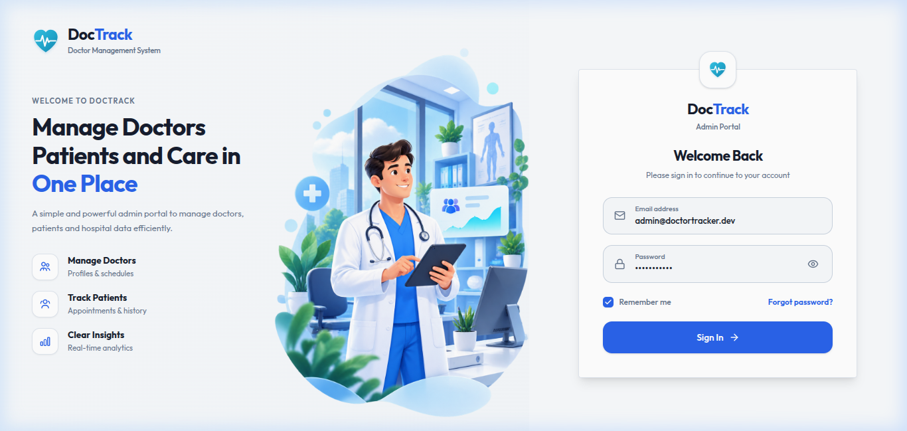
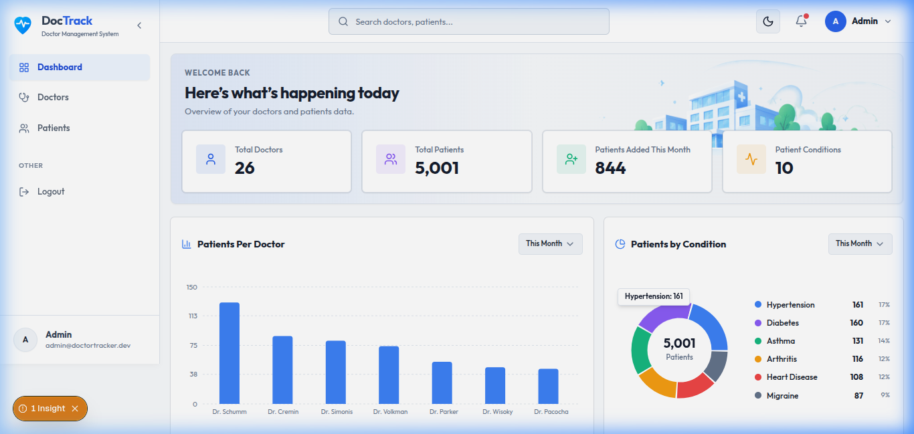
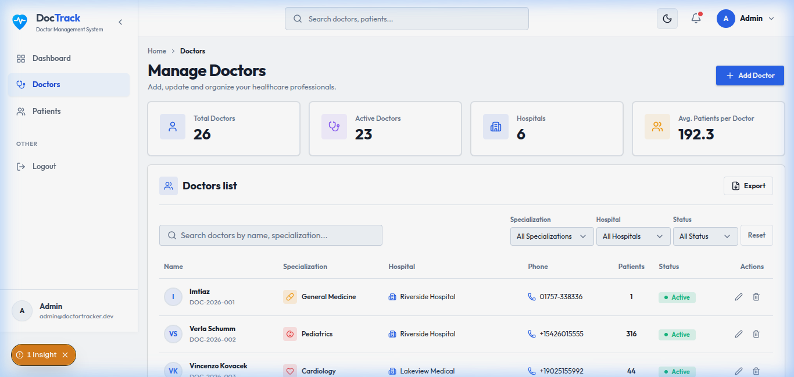
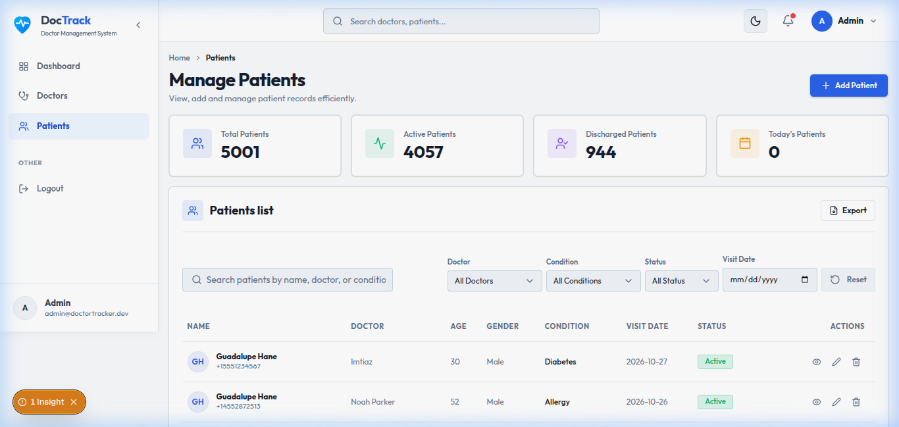
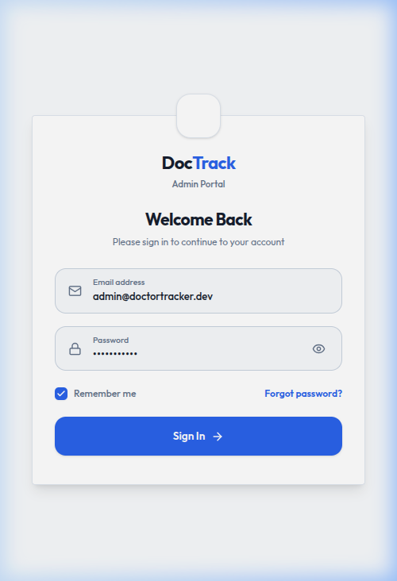
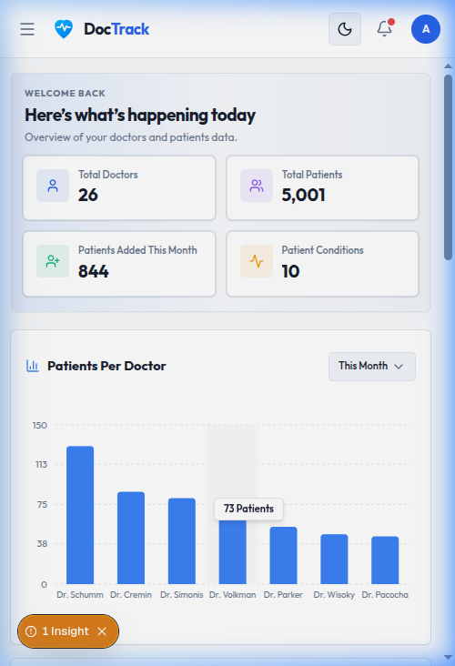
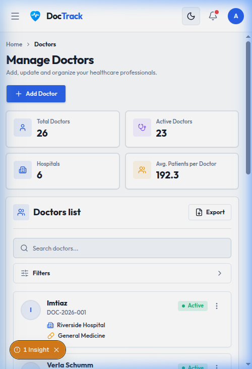
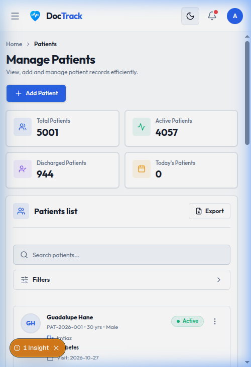
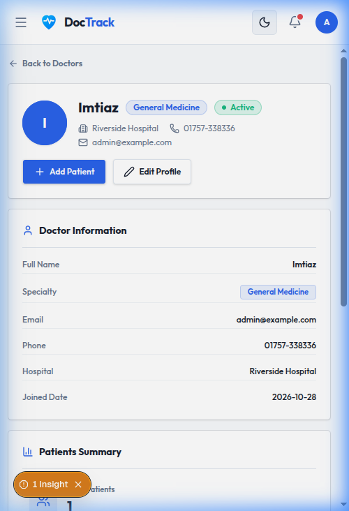

# Doctor Tracker — Admin Portal

> **A secure, high-performance admin portal for managing doctors and patients, built with Next.js 16, Express 5, and MongoDB.**

**Live demo:** _add your deployed URL here_  
**GitHub:** _https://github.com/your-org/doctor-tracker_  
**Reviewer credentials:** email `admin@doctortracker.dev` · password `Admin@12345`

---

## Description

Doctor Tracker is a secure administrative web application designed for healthcare organisations that need to manage their medical staff and patient records from a single, unified interface. Authenticated admins can onboard doctors, assign and track patients per doctor, visualise practice-wide analytics through interactive charts (patients-per-doctor, patient conditions breakdown, day/month growth trends), and drill into any doctor's roster for granular patient management — all backed by a RESTful API with optimised MongoDB queries, proper indexing, and atomic transaction guarantees.

---

## Table of Contents

1. [Tech Stack](#tech-stack)
2. [Setup Guide](#setup-guide)
3. [System Architecture](#system-architecture)
4. [Technical Decisions](#technical-decisions)
5. [Query Optimization Evidence](#query-optimization-evidence)
6. [Scalability Considerations](#scalability-considerations)
7. [Feature Overview](#feature-overview)
8. [API Reference](#api-reference)
9. [Visual Evidence](#visual-evidence)
10. [Project Structure](#project-structure)
11. [Deployment Notes](#deployment-notes)

---

## Tech Stack

| Layer | Technology |
|---|---|
| Frontend | Next.js 16 (App Router), React 19, TypeScript |
| Styling | Tailwind CSS 4, shadcn/ui, Lucide icons |
| Charts | Recharts 3 |
| Server State | TanStack Query v5 |
| Client State | Zustand v5 |
| Forms | React Hook Form + Zod |
| URL State | nuqs (filters, sort, page live in the URL) |
| Backend | Node.js ≥ 20, Express 5 |
| Auth | JWT (httpOnly cookie) + bcryptjs |
| Database | MongoDB 7 / Mongoose 8 |
| Security | Helmet, CORS, express-rate-limit |

---

## Setup Guide

### Prerequisites

- **Node.js** ≥ 20
- **MongoDB** with a replica set enabled (required for transactions)  
  _Quickest local option: `docker compose up -d` (see `server/docker-compose.yml`)_
- **npm**

### 1 — Clone the repository

```bash
git clone https://github.com/your-org/doctor-tracker.git
cd doctor-tracker
```

### 2 — Configure the server

```bash
cd server
cp .env.example .env   # then edit the values (see server/.env.example)
```

Key variables:

| Variable | Purpose |
|---|---|
| `MONGODB_URI` | Replica-set connection string (Atlas or local Docker) |
| `JWT_SECRET` | Min 32-char random string — `node -e "console.log(require('crypto').randomBytes(48).toString('hex'))"` |
| `CLIENT_ORIGIN` | Comma-separated frontend origins for CORS |
| `STATS_TIMEZONE` | IANA timezone for day/month bucketing (e.g. `Asia/Dhaka`) |
| `SEED_ADMIN_EMAIL` / `SEED_ADMIN_PASSWORD` | Admin credentials created by `npm run seed` |

### 3 — Configure the client

```bash
cd ../client
cp .env.example .env.local   # then edit if your API is not on :4000
```

| Variable | Purpose |
|---|---|
| `NEXT_PUBLIC_API_URL` | Backend base URL, e.g. `http://localhost:4000/api` |

### 4 — Start MongoDB (local replica set)

```bash
cd server
docker compose up -d   # starts mongo:7 on :27017 with rs0 replica set
```

### 5 — Install dependencies & seed data

```bash
# Server
cd server && npm install
npm run seed       # creates 1 admin + 25 doctors + 5 000 patients (default)
```

```bash
# Client
cd ../client && npm install
```

Custom seed counts (optional):

```bash
npm run seed -- --doctors=50 --patients=2000
```

### 6 — Run the application

```bash
# Terminal 1 — backend (http://localhost:4000)
cd server && npm run dev

# Terminal 2 — frontend (http://localhost:3000)
cd client && npm run dev
```

### 7 — Log in

Open http://localhost:3000 and sign in with:

| Field | Value |
|---|---|
| Email | `admin@doctortracker.dev` |
| Password | `Admin@12345` |

### Maintenance scripts

| Command | Purpose |
|---|---|
| `npm run seed` | Seed admin + sample data (wipes existing data) |
| `npm run recount` | Re-sync `patientCount` counter fields (safety net) |
| `npm run explain` | Print MongoDB query explain plans for all key queries |
| `npm run typecheck` | TypeScript type-check without emitting |

---

## System Architecture

```
┌──────────────────────────────────────────────────────────────┐
│                     Browser (Next.js 16)                      │
│                                                              │
│  ┌──────────┐  ┌──────────┐  ┌──────────┐  ┌────────────┐  │
│  │ /login   │  │/dashboard│  │ /doctors │  │ /patients  │  │
│  └────┬─────┘  └────┬─────┘  └────┬─────┘  └─────┬──────┘  │
│       │              │              │               │         │
│       └──────────────┴──────────────┴───────────────┘        │
│                              │                                │
│           TanStack Query v5  │  (SWR cache, deduplication)   │
│           Zustand v5         │  (sidebar collapse, UI state)  │
│           nuqs               │  (URL-persisted filters/page)  │
│                              │                                │
│                    axios + httpOnly cookie                    │
└──────────────────────────────┬───────────────────────────────┘
                               │  REST / JSON
                               ▼
┌─────────────────────────────────────────────────────────────┐
│                  Express 5 Server (:4000)                    │
│                                                              │
│  Middleware chain:                                           │
│  helmet → cors → morgan → json → cookieParser                │
│  → apiLimiter → router → [requireAuth] → controller         │
│                                                              │
│  Routes         Controllers       Services                   │
│  /api/auth   →  auth.ctrl     →  bcrypt + JWT sign          │
│  /api/doctors → doctor.ctrl  →  doctor.service              │
│  /api/patients → patient.ctrl →  patient.service            │
│  /api/dashboard → dash.ctrl  →  dashboard.service           │
│                                                              │
│  All inputs validated by Zod schemas before hitting service  │
└───────────────────────────────┬─────────────────────────────┘
                                │  Mongoose 8
                                ▼
┌─────────────────────────────────────────────────────────────┐
│              MongoDB 7 (Replica Set — required)              │
│                                                              │
│  ┌──────────┐   ┌────────────────┐   ┌────────────────────┐ │
│  │  users   │   │    doctors     │   │      patients      │ │
│  │ email    │   │ nameLower      │   │ doctorId+createdAt │ │
│  │ (unique) │   │ specialization │   │ condition+createdAt│ │
│  └──────────┘   │ +createdAt     │   │ status+createdAt   │ │
│                 │ hospital       │   │ nameLower          │ │
│                 │ +createdAt     │   │ visitDate          │ │
│                 │ patientCount   │   │ createdAt+_id      │ │
│                 │ createdAt      │   └────────────────────┘ │
│                 └────────────────┘                          │
│  Transactions on: patient create / update / delete           │
└─────────────────────────────────────────────────────────────┘
```

### Data flow — Add Patient (end-to-end example)

1. Admin fills `AddPatientModal` → React Hook Form + Zod validates client-side
2. `usePatients.createPatient()` fires `POST /api/doctors/:id/patients`
3. Express validates body via `CreatePatientSchema` (Zod); rejects on error
4. `patient.service.createPatient()` opens a MongoDB **transaction**:
   - `Doctor.findByIdAndUpdate(id, { $inc: { patientCount: 1 } })`
   - `Patient.create([{ …fields, doctorId }])`
5. Both writes commit atomically; any error aborts the session
6. TanStack Query invalidates `['patients']` and `['doctors']` cache keys
7. UI refreshes automatically without a full page reload

---

## Technical Decisions

### Decision 1 — Denormalized `patientCount` on the Doctor document

**Problem:** Computing "patients per doctor" at read time means a `$lookup`/`$group` on every doctors-list request, with cost that grows with patient volume, and the result cannot be sorted by a standard index.

**Options considered:**

| Approach | Pros | Cons |
|---|---|---|
| `$lookup + $group` on every list request | Always accurate | Cost grows with patient volume; can't index-sort the computed count |
| `Patient.countDocuments({ doctorId })` per row | Simple | N+1 pattern — one extra round-trip per doctor row on every page load |
| **Denormalized `patientCount` on Doctor** | O(1) read; index-sortable (`patientCount: -1`) | Requires atomic, disciplined write path; potential for counter drift |

**Decision:** `patientCount` is stored on each `Doctor` document. Every patient write (create, update with doctor reassignment, delete) runs inside a MongoDB **transaction** that atomically applies `$inc: { patientCount: ±1 }` alongside the patient mutation. The `npm run recount` script reconciles any drift by summing the `patients` collection.

**Trade-offs acknowledged:**
- Writes are slightly heavier (transaction overhead)
- Replica set is required (already needed for this project's transactions)
- Doctor deletion uses `Patient.exists({ doctorId })` — not the counter — to guard against stale counts
- Counter drift is possible on crash mid-transaction, mitigated by `recount`

---

### Decision 2 — TanStack Query v5 instead of Redux Toolkit / React Context

**Problem:** The frontend needs to cache API responses, deduplicate concurrent requests, handle loading/error/stale states, and keep the UI consistent after mutations — without prop-drilling or excessive boilerplate.

**Options considered:**

| Approach | Pros | Cons |
|---|---|---|
| React Context + `useEffect` | Zero dependency | Manual cache, dedup, loading states — prone to request waterfalls |
| Redux Toolkit (RTK Query) | Mature, DevTools, powerful | Overkill for CRUD dashboard; larger bundle; steep setup |
| **TanStack Query v5** | Purpose-built server-state; SWR cache; `invalidateQueries` | Requires a separate solution for non-server state |

**Decision:** TanStack Query v5 handles all server state. After each mutation, `queryClient.invalidateQueries` refetches only the affected keys, keeping the UI consistent after writes. **Zustand** handles the small slice of client-only UI state (sidebar collapse toggle). **nuqs** keeps filter, sort, and page values in the URL query string so views are shareable and survive a hard refresh.

---

## Query Optimization Evidence

All key queries run against **26 doctors and 5 001 patients** (`npm run explain` output):

| Query | Plan | Keys examined | Docs examined | Returned | ms |
|---|---|---|---|---|---|
| Patient — doctor's list, newest 10 | `LIMIT > FETCH > IXSCAN(doctorId_1_createdAt_-1)` | 10 | 10 | 10 | 0 |
| Patient — condition filter, newest 10 | `LIMIT > FETCH > IXSCAN(condition_1_createdAt_-1)` | 10 | 10 | 10 | 0 |
| Patient — name prefix search "an" | `LIMIT > FETCH > IXSCAN(nameLower_1)` | 10 | 10 | 10 | 0 |
| Patient — visit date range | `LIMIT > FETCH > IXSCAN(visitDate_-1)` | 10 | 10 | 10 | 0 |
| Patient — default list, newest 10 | `LIMIT > FETCH > IXSCAN(createdAt_-1__id_-1)` | 10 | 10 | 10 | 2 |
| Doctor — specialization filter | `LIMIT > FETCH > IXSCAN(specialization_1_createdAt_-1)` | 3 | 3 | 3 | 0 |
| Doctor — sort by patientCount | `LIMIT > FETCH > IXSCAN(patientCount_-1)` | 10 | 10 | 10 | 0 |

**All 7 queries use IXSCAN — zero collection scans.** Keys examined equals documents returned in every case.

### Index strategy (ESR rule applied)

| Collection | Index | Covers |
|---|---|---|
| patients | `{ doctorId: 1, createdAt: -1 }` | Doctor detail patient list |
| patients | `{ condition: 1, createdAt: -1 }` | Condition filter + date sort |
| patients | `{ status: 1, createdAt: -1 }` | Status filter + date sort |
| patients | `{ nameLower: 1 }` | Prefix-regex name search |
| patients | `{ visitDate: -1 }` | Visit-date range filter |
| patients | `{ createdAt: -1, _id: -1 }` | Default list sort with tie-breaker |
| doctors | `{ specialization: 1, createdAt: -1 }` | Specialization filter |
| doctors | `{ hospital: 1, createdAt: -1 }` | Hospital filter |
| doctors | `{ nameLower: 1 }` | Name search |
| doctors | `{ patientCount: -1 }` | Sort by patient count |
| doctors | `{ email: 1 }` unique | Duplicate email guard |
| users | `{ email: 1 }` unique | Login lookup |

---

## Scalability Considerations

| Area | Current approach | Path to scale |
|---|---|---|
| **Pagination** | `skip`/`limit` (sufficient up to ~100k docs) | Replace with keyset pagination (`_id`/`createdAt` cursor) to avoid the skip penalty at high offsets |
| **Full-text search** | Prefix regex on `nameLower` (fast for prefix; no fuzzy/typo tolerance) | Swap in **Atlas Search** (Lucene) for fuzzy matching and scored results without schema changes |
| **Dashboard stats** | Computed on every request with `estimatedDocumentCount` + parallel aggregations | Cache the stats payload in Redis or Next.js `unstable_cache` with a 60-second TTL |
| **Write throughput** | Single-node Express; transactions serialise patient counter writes | Horizontal scale with a load balancer; MongoDB handles concurrent transactions at the collection level |
| **Session management** | Stateless JWT; no server-side session store needed | JWT expiry set via `JWT_EXPIRES_DAYS`; add token rotation if refresh tokens are introduced |

---

## Feature Overview

### Authentication
- Login / logout via JWT in `httpOnly` cookie
- Cookie is `SameSite=Lax` in development, `SameSite=None; Secure` in production — the latter allows cross-origin requests when the client (e.g. Vercel) and API (e.g. Render) are on different domains
- All API routes require the `requireAuth` middleware (JWT verification)
- Login endpoint is rate-limited (`express-rate-limit`) to prevent brute-force
- Constant-time dummy hash prevents email enumeration timing attacks

### Doctor Management
- Create / view / search / filter (specialization, hospital, date range) / sort / paginate
- Doctor detail page: active vs. discharged patient counts, full patient roster
- Add / delete patients directly from the doctor detail page
- Delete guard: server rejects deletion if `Patient.exists({ doctorId })` is truthy

### Patient Management
- Global patient list with search, filter (condition, status, doctor, visit-date range), pagination
- Inline edit modal — all fields editable including doctor reassignment (atomic counter transfer)
- Delete with atomic doctor counter decrement

### Dashboard Analytics
- Stat cards: Total Doctors, Total Patients, Active Patients, Avg Patients/Doctor
- Month-over-month and day-over-day growth badges
- Bar chart: patients registered per day (30-day rolling)
- Bar chart: top 10 doctors by patient count (timeframe-filterable)
- Doughnut chart: patients by medical condition (timeframe-filterable)
- Recent patients table (last 5 added)
- Doctor directory table (top 5 by patient count)

---

## API Reference

### Auth
| Method | Endpoint | Auth | Description |
|---|---|---|---|
| POST | `/api/auth/login` | ❌ | Login — rate-limited |
| POST | `/api/auth/logout` | ❌ | Clear session cookie |
| GET | `/api/auth/me` | ✅ | Current authenticated user |

### Doctors
| Method | Endpoint | Auth | Description |
|---|---|---|---|
| GET | `/api/doctors` | ✅ | List — `?search&specialization&hospital&from&to&sort&page&limit` |
| POST | `/api/doctors` | ✅ | Create doctor |
| GET | `/api/doctors/filters` | ✅ | Dropdown option values |
| GET | `/api/doctors/:id` | ✅ | Doctor detail + active/discharged counts |
| PATCH | `/api/doctors/:id` | ✅ | Update doctor fields |
| DELETE | `/api/doctors/:id` | ✅ | Delete (blocked if patients exist) |
| GET | `/api/doctors/:id/patients` | ✅ | Doctor's patient list (paginated) |
| POST | `/api/doctors/:id/patients` | ✅ | Add patient to doctor |
| DELETE | `/api/doctors/:id/patients/:patientId` | ✅ | Remove patient from doctor |

### Patients
| Method | Endpoint | Auth | Description |
|---|---|---|---|
| GET | `/api/patients` | ✅ | Global list — `?search&condition&status&doctorId&from&to&sort&page&limit` |
| GET | `/api/patients/filters` | ✅ | Dropdown option values |
| GET | `/api/patients/:id` | ✅ | Patient detail |
| PATCH | `/api/patients/:id` | ✅ | Update patient (doctor transfer supported) |
| DELETE | `/api/patients/:id` | ✅ | Delete patient |

### Dashboard
| Method | Endpoint | Auth | Description |
|---|---|---|---|
| GET | `/api/dashboard/stats` | ✅ | Full stats payload |
| GET | `/api/dashboard/recent-patients` | ✅ | 5 most recent patients |
| GET | `/api/dashboard/doctor-directory` | ✅ | Top 5 doctors by patient count |
| GET | `/api/dashboard/patients-per-doctor` | ✅ | Bar chart data (`?timeframe=month`) |
| GET | `/api/dashboard/patients-by-condition` | ✅ | Doughnut chart data (`?timeframe=month`) |

---

## Visual Evidence

### Desktop views

| Login | Dashboard |
|---|---|
|  |  |

| Doctors list | Patients list |
|---|---|
|  |  |

### Mobile views (390 × 844 — iPhone 14)

| Login | Dashboard | Doctors |
|---|---|---|
|  |  |  |

| Patients | Doctor detail |
|---|---|
|  |  |

---

## Project Structure

```
doctor-tracker/
├── docs/screenshots/           # README screenshots
├── client/                     # Next.js 16 frontend
│   ├── .env.example
│   └── src/
│       ├── app/
│       │   ├── (auth)/login/   # Login page
│       │   └── (dashboard)/    # Protected layout + pages
│       │       ├── dashboard/  # Analytics dashboard
│       │       ├── doctors/    # Doctors list + [id] detail
│       │       └── patients/   # Global patients list
│       ├── components/
│       │   ├── dashboard/      # StatCard, PatientsPerDoctorChart, PatientsByConditionChart
│       │   ├── doctors/        # AddDoctorModal, DoctorFilters, DoctorsTable
│       │   ├── patients/       # AddPatientModal, PatientFilters, PatientsTable
│       │   └── layout/         # Sidebar, TopBar
│       ├── hooks/              # useAuth, useDoctors, usePatients, useDashboardStats
│       ├── store/              # Zustand UI store
│       ├── lib/                # axios instance, utils
│       └── types/              # Shared TypeScript types
│
└── server/                     # Express 5 backend
    ├── .env.example
    ├── docker-compose.yml      # Local MongoDB 7 replica set
    └── src/
        ├── controllers/        # Thin request/response handlers
        ├── services/           # Business logic (doctor, patient, dashboard)
        ├── models/             # Mongoose schemas + indexes
        ├── routes/             # Express routers
        ├── middleware/         # requireAuth, error handler, rate limiter
        ├── validators/         # Zod input schemas
        ├── utils/              # errors, query helpers, transaction wrapper
        ├── config/             # env validation, cookie options, DB connect
        └── scripts/            # seed, recount, explain
```

---

## Deployment Notes

**Architecture choice:** The PRD specification listed two options (Next.js-integrated backend vs. a separate standalone Express server). This project uses **a separate Express server** so that the API can be deployed and scaled independently of the frontend.

**Recommended deployment targets:**
- Client: Vercel
- Server: Render / Railway / Fly.io
- Database: MongoDB Atlas (replica set included by default)

**Cross-origin cookie:** When the client and API are on different domains, the JWT cookie is set with `SameSite=None; Secure` (production). Ensure:
1. `CLIENT_ORIGIN` in the server `.env` lists the exact Vercel domain
2. The API is served over HTTPS (required for `Secure` cookies)
3. The frontend `NEXT_PUBLIC_API_URL` points to the deployed API URL

**Environment variables to update for production:**

| Variable | Production value |
|---|---|
| `NODE_ENV` | `production` |
| `MONGODB_URI` | Atlas connection string with replica set |
| `JWT_SECRET` | 48-char+ random secret |
| `CLIENT_ORIGIN` | Your Vercel domain, e.g. `https://doctor-tracker.vercel.app` |

---

## Assumptions

- The PRD's section 6 lists two conflicting architectures. This implementation follows the **separate standalone server** model (Next.js frontend + Express API) as it better matches the REST API evaluation criterion and real-world production patterns.
- The replica set requirement (for MongoDB transactions) is met locally via the bundled `docker-compose.yml` and in production via MongoDB Atlas.
